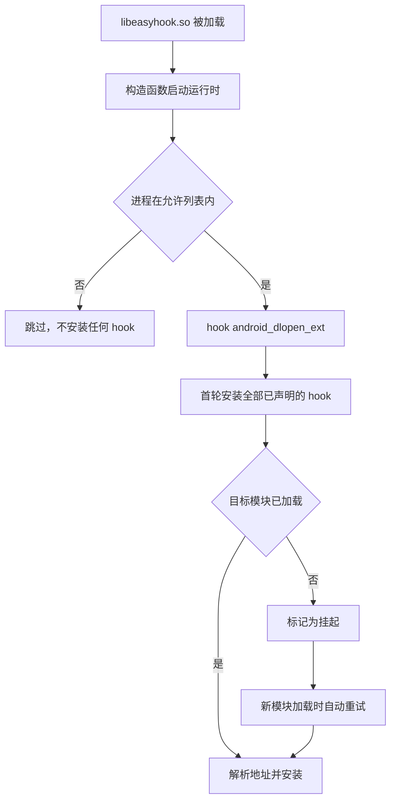

# Easy Hook

**面向新手的 Android 原生 Hook 框架**

只写一个 cpp，声明要 hook 什么、hook 成什么，其余全部自动完成。

[Android 11+](#构建)
[ABI arm64-v8a](#构建)
[C++23](CMakeLists.txt)
[CMake 3.28+](CMakeLists.txt)

[功能支持](#功能支持情况) ·
[快速开始](#快速开始) ·
[三种定位方式](#三种定位方式) ·
[ART hook](#artjava-方法hook) ·
[内置插件](#内置插件) ·
[构建](#构建) ·
[日志与排查](#日志与排查) ·
[架构](#架构) ·
[开源依赖](#开源依赖)


## 这个框架解决什么问题

写一个 native hook，通常要自己处理符号解析、模块基址换算、hook 安装、原函数保存、
目标库还没加载时的等待、以及各种失败情况的排查。这些和你真正想做的事无关。

Easy Hook 把这些全部收进引擎，你只需要在 `user/` 目录写一个 cpp，声明两件事：

- **hook 什么**：模块名加符号名、模块名加偏移，或者一段字节特征码
- **hook 成什么**：一个函数体，需要时用 `EASY_ORIGINAL(...)` 调回原逻辑

不需要写注册代码，不需要写初始化代码，不需要改 CMakeLists，也不需要关心目标库有没有加载。

## 功能支持情况


| 能力                              | 状态  | 说明                                                       |
| ------------------------------- | --- | -------------------------------------------------------- |
| 按符号名 hook 原生函数                  | ✅   | 支持导出符号与 `.symtab` 中的内部符号                                 |
| 按模块加偏移 hook                     | ✅   | 自动换算加载基址，可直接用 IDA 里读到的偏移                                 |
| 按字节特征码 hook                     | ✅   | 支持通配符，命中多处会报 `pattern_ambiguous`                         |
| 目标库未加载时自动补装                     | ✅   | 监听模块加载，加载后立即补装                                           |
| 运行期动态 hook 任意地址                 | ✅   | `easy::HookFunction`，用于地址只能在运行期取得的目标                     |
| 按进程过滤                           | ✅   | `EASY_HOOK_ONLY_IN`，支持 `包名:子进程` 前缀匹配                     |
| ART（Java 方法）hook                | ✅   | 接入 LSPlant，见下文                                           |
| 从 `.gnu_debugdata` 解析 libart 符号 | ✅   | 通过系统自带库实现                              |
| 与 LSPosed 共存                    | ✅   | LSPlant 静态内嵌且不导出符号，生成桩类名独立                               |
| 卸载已安装的 hook                     | ✅   | 原生用 `easy::UnhookFunction`，ART 用 `ArtHook::UnhookMethod` |
| JNI 原生方法 hook                   | ❌   | ``` 替换 JNINativeMethod.fnPtr 尚未完成 ```                    |
| 导入表 / PLT 替换                    | ❌   | 暂未实现                                                     |
| arm64-v8a 以外的 ABI               | ❌   | 没有测试                                                     |


## 快速开始

在 `user/` 目录下新建任意名字的 cpp：

```cpp
#include "easy_hook/easy_hook.hpp"

EASY_HOOK_SYMBOL(OpenFile, "libc.so", "open", int, const char* path, int flags) {
    EASY_LOG("open path=%s flags=0x%x", path, flags);
    return EASY_ORIGINAL(path, flags);
}
```

然后构建：

```powershell
.\scripts\build-android.ps1
```

产物是 `build-android-ninja/libeasyhook.so`。把它加载进目标进程即可生效，
ROM 预置、Zygisk 模块、手动 `dlopen` 都可以，框架不绑定任何一种加载方式。

宏的参数顺序固定为 `(名字, 目标定位..., 返回类型, 参数列表...)`。
第一个参数是你给这个 hook 起的名字，只用于日志和状态查询，随便起，不要重复即可。

## 三种定位方式


### 按符号名

最常用。符号可以是未导出的内部符号，框架会解析目标模块的 `.symtab` 与 `.dynsym`。

```cpp
EASY_HOOK_SYMBOL(PrettyMethod, "libart.so",
                 "_ZN3art9ArtMethod12PrettyMethodEb",
                 const char*, void* thiz, bool with_signature) {
    const char* name = EASY_ORIGINAL(thiz, with_signature);
    EASY_LOG("PrettyMethod -> %s", name);
    return name;
}
```

模块名必须填写，且尽量填准。留空会让底层符号解析器遍历并映射所有已加载模块，代价极高。

### 按模块加偏移

偏移**直接填 IDA 中显示的地址**。框架内部用模块的 `load_bias` 换算成运行时绝对地址，
并校验该地址确实落在某个已映射段内，填错时会明确报错而不是静默 hook 到错误位置。

```cpp
EASY_HOOK_OFFSET(DamageCalculate, "libgame.so", 0x1A2B0, int, void* self, int raw) {
    EASY_LOG("damage raw=%d forced to 0", raw);
    return 0;
}
```

> [!NOTE]
> 这里不能用 `/proc/self/maps` 的首行基址加偏移。模块存在多个 PT_LOAD 段时两者并不相等，
> 那是一个常见的错误来源。框架已经处理好这一点，你只管填 IDA 里看到的地址。


### 按字节特征码

应对无符号且版本多变的目标。`??` 表示任意字节，分隔符可以是空格或逗号。

```cpp
EASY_HOOK_PATTERN(EncryptBuffer, "libgame.so", "FF 83 00 D1 ?? ?? 00 F9",
                  int, void* buffer, int length) {
    EASY_LOG("encrypt length=%d", length);
    return EASY_ORIGINAL(buffer, length);
}
```

搜索范围限定在目标模块的可执行段。**命中多于一处会拒绝安装**，因为那说明特征码不够唯一，
继续安装会在不同版本的目标库上 hook 到错误位置。遇到这种情况请加长特征码。

特征码首字节不允许是通配符，否则搜索会退化为逐字节全量比对且极易误命中。

## 可选能力


### 只在指定进程生效

注入到 zygote 后所有 app 进程都会继承，通常需要过滤。在任意 user cpp 中声明：

```cpp
EASY_HOOK_ONLY_IN("com.example.game")
```

可重复声明以允许多个进程。支持 `包名:子进程` 形式的匹配，即 `com.example` 也会覆盖
`com.example:remote`。完全不声明时不做过滤，注入到哪就在哪生效。

### 不调用原函数

直接 return，不写 `EASY_ORIGINAL` 即可完全接管该函数。

### 判断是否安装成功

`EASY_HAS_ORIGINAL()` 返回原函数是否已成功接管，用于替换函数中需要区分该情况的场合。

### 主动查询状态

```cpp
easy::DumpStatus();                 // 打印每个 hook 的目标、状态和绝对地址
const auto pending = easy::PendingCount();  // 仍在等待目标模块加载的数量
const auto summary = easy::InstallAll();    // 主动触发一轮安装
```


## 安装时机

框架在 `libeasyhook.so` 被加载时通过构造函数自动启动，你不需要调用任何初始化函数。

启动时会先 hook `android_dlopen_ext` 建立模块加载监听，再执行首轮安装。
目标模块尚未加载的 hook 会进入**挂起**状态，等到该模块被加载时自动补装。
因此即使你要 hook 的是一个稍后才被 `dlopen` 进来的库，也不需要做任何额外处理。




只有"目标模块未加载"属于可重试的暂时性失败。符号不存在、偏移越界、特征码不唯一
都是终态，不会反复重试，以免在每次 `dlopen` 上做无用的解析。

## 构建


### 环境要求


| 项目          | 要求                  |
| ----------- | ------------------- |
| 宿主系统        | Windows + WSL       |
| CMake       | 3.28 或更高            |
| 构建器         | Ninja               |
| Android NDK | r29                 |
| 目标 ABI      | `arm64-v8a`         |
| 最低 API      | Android 11 / API 30 |
| C++ 标准      | C++23               |


### 一键构建

```powershell
.\scripts\build-android.ps1
```

指定自定义路径与选项：

```powershell
.\scripts\build-android.ps1 `
  -NdkPath /opt/android-ndk-r29 `
  -BuildDir build-android-ninja `
  -BuildType Release `
  -DebugLogging ON
```

**在 WSL 中手动构建**

```bash
cmake -G Ninja -S . -B build-android-ninja \
  -DCMAKE_BUILD_TYPE=Release \
  -DCMAKE_TOOLCHAIN_FILE=/opt/android-ndk-r29/build/cmake/android.toolchain.cmake \
  -DANDROID_ABI=arm64-v8a \
  -DANDROID_PLATFORM=android-30 \
  -DANDROID_STL=c++_static \
  -DEASY_HOOK_DEBUG_DEFAULT=ON

cmake --build build-android-ninja --target easyhook --parallel
sha256sum build-android-ninja/libeasyhook.so
```

### 部署到 ROM

框架靠 `app_process64` 的 `DT_NEEDED` 注入，因此要让它生效，解包后的分区里必须同时满足四件事。
少任何一件都不会报错，只是静默不生效，所以逐条核对比事后查日志省事：

```bash
# 1. 放入并剥离。带调试信息的产物有十余 MB，剥离后只剩数百 KB，功能完全一致
cp build-android-ninja/libeasyhook.so  $ROM/system/system/lib64/libeasyhook.so
llvm-strip --strip-all                 $ROM/system/system/lib64/libeasyhook.so

# 2. 把注入点指向它（原 ROM 依赖的是别的库，替换其 NEEDED 项即可）
patchelf --replace-needed libwhite.so libeasyhook.so $ROM/system/system/bin/app_process64
patchelf --print-needed $ROM/system/system/bin/app_process64 | head -1   # 应为 libeasyhook.so
```

```text
# 3. config/system_fs_config 增加一行权限条目
system/system/lib64/libeasyhook.so 0 0 0644

# 4. config/system_file_contexts 增加一行 SELinux 上下文（注意 . 要转义）
/system/system/lib64/libeasyhook\.so u:object_r:system_lib_file:s0
```

改完重新打包刷入。注意 `/` 通常是只读的 erofs，无法 remount 成读写，
也就没有"直接 push 覆盖"这条捷径——每次验证都得走完整的打包刷机流程。

## 日志与排查

```bash
adb logcat -s "EASY-HOOK:*"
```

开启调试日志后还会追加写入 `/data/local/tmp/easy_hook.log`。


| 系统属性                        | 默认值         | 作用                     |
| --------------------------- | ----------- | ---------------------- |
| `persist.easy_hook.debug`   | 构建配置，默认 `1` | 输出 Info 级日志并写入日志文件     |
| `persist.easy_hook.verbose` | `0`         | 额外输出 Debug 级日志，含地址解析细节 |


### 日志标签


| 标签                | 关注内容                                   |
| ----------------- | -------------------------------------- |
| `bootstrap`       | 库是否被成功加载、运行时启动结果                       |
| `runtime`         | 进程过滤判定、模块监听是否就绪、首轮安装汇总                 |
| `registry`        | 每个 hook 的目标、状态与解析出的绝对地址                |
| `engine`          | 单个 hook 的定位与安装结果                       |
| `offset-locator`  | 偏移换算细节，可与 IDA 核对                       |
| `pattern-locator` | 特征码解析与命中次数                             |
| `module-watcher`  | 新模块加载与挂起项补装                            |
| `art-hook`        | ART 引擎初始化、libart 符号表规模                 |
| `elf-symbols`     | libart 符号解析结果，含 `.gnu_debugdata` 中的符号数 |
| `xz`              | `.gnu_debugdata` 的解压情况                 |
| `user`            | `EASY_LOG` 输出的内容                       |


注意标签是消息正文里的模块名，logcat 的标签统一是 `EASY-HOOK`，
按模块名做 `logcat -s` 过滤是抓不到任何东西的。

### 安装状态含义


| 状态                       | 含义与处理                                |
| ------------------------ | ------------------------------------ |
| `installed`              | 已成功安装                                |
| `module_not_loaded`      | 目标模块尚未加载，等待自动补装，通常无需处理               |
| `symbol_not_found`       | 模块已加载但符号不存在，检查符号名拼写与是否被裁剪            |
| `offset_out_of_range`    | 偏移不在任何已映射段内，检查是否填错模块或填了文件偏移          |
| `pattern_invalid`        | 特征码语法错误，或首字节是通配符                     |
| `pattern_not_found`      | 可执行段中没有命中，检查目标版本是否变化                 |
| `pattern_ambiguous`      | 命中多处，特征码不够唯一，需要加长                    |
| `backend_failed`         | 地址已解析但 inline hook 安装失败，通常是目标指令无法重定位 |
| `skipped_process_filter` | 当前进程不在 `EASY_HOOK_ONLY_IN` 允许列表中     |


### 排查顺序

1. **完全没有日志**：确认 `libeasyhook.so` 真的被加载，构造函数日志 `libeasyhook loaded` 是否出现。
  注意应用进程无权写 `/data/local/tmp/easy_hook.log`（属主是 shell），
   它们的日志只能从 logcat 观察，只看日志文件会误判成"代码完全没执行"。
   另外构造函数只在 zygote 里执行一次，fork 出来的应用进程不会重跑，看不到该行属正常
2. **提示 no_registration**：`user/` 下没有任何 hook 声明，或声明被 `#if 0` 注释掉了
3. **一直是 pending**：确认目标模块名拼写正确，并检查 `module-watcher` 是否成功建立监听
4. **地址对不上**：开启 verbose，用 `offset-locator` 打印的 `load_bias` 与绝对地址和 IDA 核对


## 架构

```text
main/
├── include/easy_hook/
│   ├── easy_hook.hpp       使用者唯一需要包含的总头
│   ├── macros.hpp          三个 hook 宏与辅助宏
│   ├── core/               日志、目标规格、注册表、引擎、运行时、进程过滤
│   ├── module/             基于 dl_iterate_phdr 的模块查询
│   ├── pattern/            字节特征码解析与搜索
│   ├── locator/            符号、偏移、特征码三种定位器
│   ├── backend/            inline hook 抽象接口与 Dobby 实现
│   ├── art/                ART 方法 hook：libart 符号表、XZ 解压、LSPlant 门面
│   └── loader/             模块加载监听
├── src/                    与 include 一一对应的实现
├── plugins/                随框架分发的参考插件
│   ├── fod/                小米 + Flyme 屏下指纹修复
│   ├── art_demo/           ART 方法 hook 演示
│   └── example_hooks.cpp   三种定位方式的最小示例
├── user/                   你写自己插件的地方，初始为空
├── dobby/                  上游 Dobby 依赖（原生 inline hook）
├── third_party/lsplant/    上游 LSPlant 依赖（ART 方法 hook）
├── tools/                  回调类 dex 生成脚本、libart 符号解析探针
└── scripts/                构建脚本
```

`plugins/` 与 `user/` 都会被自动收录并加入头文件搜索路径，两者的区别只在职责：
前者是可以照抄的参考实现，后者是你自己的东西。不需要参考插件时整个删掉即可，
构建只要求两处合计至少有一个 `.cpp`。

### 关键设计

**引擎不依赖具体 hook 库。** 引擎只面向 `backend::InlineHookBackend` 抽象接口编程，
Dobby 只是它的一个实现。后续接入 ART 方法 hook 时新增一个 backend 即可，
引擎、注册表和定位层都不需要改动。

**注册表使用函数内静态单例。** 每个 hook 的自注册对象分散在不同翻译单元的静态构造期，
单例延迟到首次访问时才创建，从根本上避免静态初始化顺序问题。

**用户代码编译为 OBJECT 库。** 静态库中未被引用的目标文件会被链接器丢弃，
那样每个 hook 的自注册对象都不会执行，所有 hook 都将静默失效。
OBJECT 库的目标文件会被无条件链入，保证注册一定发生。

**用户代码与框架代码使用不同的告警级别。** 框架本体开启 `-Wpedantic -Wconversion`,
用户 hook 只开 `-Wall -Wextra`，避免新手在写替换函数时被严格告警劝退。

## ART（Java 方法）hook

三个声明式宏作用于原生指令，覆盖不到运行在 ART 上的 Java 方法——
那些方法可能处于解释执行，也可能已被 JIT/AOT 编译，改写入口地址既不稳定也盖不全执行路径。
这类目标由 `easy::art::ArtHook` 接管，底层是 LSPlant。

```cpp
#include "easy_hook/art/art_hook.hpp"

// 需要一个具备隐藏 API 访问权限的 JNIEnv，取得后初始化一次即可
const auto status = easy::art::ArtHook::Init(env);

// 之后即可按方法 hook；backup 为可反射调用的原方法
jobject backup = easy::art::ArtHook::HookMethod(env, target_method, hooker_object,
                                                callback_method);
```

`plugins/art_demo/` 是一个完整可运行的示例：把系统设置里的某段文案替换成另一段。
它演示了这类 hook 绕不开的三件事——

**回调类必须随 so 分发。** LSPlant 要求提供一个带 `callback(Object[])` 的 Java 对象，
而注入型框架无法指望目标进程里存在自己的类。示例把回调类编译成 dex 内嵌进 so，
运行时用 `InMemoryDexClassLoader` 从内存加载，不落地临时文件。
改动回调逻辑后需重新运行 `tools/build_art_demo_dex.sh` 重新生成内嵌字节。

**进程判定不能在 fork 后立刻做。** 应用进程刚从 zygote fork 出来时尚未改名，
此刻 `/proc/self/cmdline` 仍是 zygote 的命令行。示例把判定推迟到安装线程，
等进程名稳定后再决定装不装。注意改名发生在同一个 pid 内，任何按 pid 失效的缓存都察觉不到。

**要挂对取值路径。** XML 里的 `android:title` 由 `TypedArray` 直接读 AssetManager 字符串池，
不经过 `Resources.getText`；而 `TextView.setText` 返回 void，只看返回值也拦不到。
示例的目标表因此分三层覆盖，并支持在调用原方法前改写入参。

### 与 LSPosed 共存

LSPlant 全部静态并入 `libeasyhook.so`，配合 `-Wl,--exclude-libs,ALL` 使其符号不出现在动态符号表中，
两边各持一份互不干扰；同时生成桩类名从默认的 `LSPHooker_` 改为 `EasyHooker_`，避免与 LSPosed 撞名。

## 内置插件

`plugins/` 下是随框架分发的参考实现，可以照着写，用不上就整个删掉。

### 小米 + Flyme 屏下指纹修复 · `plugins/fod/`

让 Flyme 在小米硬件上正确驱动屏下指纹。修复分两端协作：JNI 反射负责判断"何时该亮"
并修正传感器类型、位置与调度器状态，小米 AIDL 与 mi_display 节点负责实际点亮。


| 进程                  | 做的事                              |
| ------------------- | -------------------------------- |
| `system_server`     | 修正传感器与调度器，管理 FOD 会话，解开卡死的清理与挑战任务 |
| Settings / SystemUI | 识别指纹 Binder 事务，补齐按下、抬起与会话关闭动作    |
| 其余进程                | 完全不介入                            |


> **仅供参考，不保证通用。** 这份实现是针对特定机型与 ROM 组合调出来的，
> 依赖小米的厂商 AIDL 接口、`mi_display` 节点路径，以及 Flyme 框架侧的类与字段名。
> 换机型或换 ROM 版本这些前提都可能不成立。把它当作"如何用本框架做一个复杂功能"的样例，
> 而不是拿来即用的补丁。`plugins/fod/fod_hooks.cpp` 顶部的 `FOD_FIX_ENABLED` 置 0 即可整体停用。


### ART 方法 hook 演示 · `plugins/art_demo/`

替换系统设置里的一段文案，用来验证 ART hook 通路是否完整。
它同时是 ART 插件的最小骨架：内嵌回调类 dex、注入目标进程、挂目标方法、按文本命中替换。
上一节列出的三个坑（回调类分发、进程判定时机、取值路径）都在这份代码里有对应处理。

### 三种定位方式示例 · `plugins/example_hooks.cpp`

符号、偏移、特征码三种写法各一例，默认由文件顶部的 `EASY_HOOK_EXAMPLE_ENABLED` 关闭。
其中 hook `libc.so` 的 `open` 那一例保留了注释说明：框架日志自身也会调用 `open`，
早期版本因此在 zygote 启动阶段形成同线程重入并死锁整机。这类"目标函数被自己的日志用到"
的重入陷阱，是写 hook 时最容易忽略的一类。

## 开源依赖

本框架用 C++23 编写，两项核心能力都建立在成熟的开源项目之上：原生指令改写交给 Dobby，
ART 托管方法改写交给 LSPosed 的 LSPlant。框架自身做的是把它们统一到一套声明式接口之下，
并补齐符号解析、延迟安装、进程过滤与排查手段。

| 项目 | 用途 | 许可证 |
| --- | --- | --- |
| [Dobby](https://github.com/jmpews/Dobby) | 原生函数的 inline hook 与符号解析 | Apache-2.0 |
| [LSPlant](https://github.com/LSPosed/LSPlant) | ART（Java 方法）hook 引擎 | LGPL-3.0 |
| [DexBuilder](https://github.com/LSPosed/DexBuilder) | LSPlant 生成桩类所需，随其一同引入 | LGPL-3.0 |
| [parallel-hashmap](https://github.com/greg7mdp/parallel-hashmap) | DexBuilder 的哈希容器依赖 | Apache-2.0 |

---


把 hook 的复杂度收进框架，把注意力留给真正要解决的问题。

