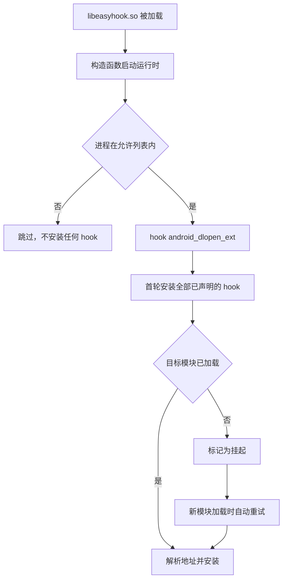

# Easy Hook

**面向新手的 Android 原生 Hook 框架** —— 只写一个 cpp，声明要 hook 什么、hook 成什么，其余全部自动完成。


[功能](#功能支持情况) ·
[快速开始](#快速开始) ·
[插件](#插件编写与配置) ·
[定位方式](#三种定位方式) ·
[ART hook](#artjava-方法hook) ·
[内置插件](#内置插件) ·
[构建](#构建) ·
[排查](#日志与排查) ·
[架构](#架构) ·
[依赖](#开源依赖)

## 这个框架解决什么问题

写一个 native hook，通常要自己处理符号解析、模块基址换算、hook 安装、原函数保存、
目标库还没加载时的等待，以及各种失败情况的排查。这些和你真正想做的事无关。

Easy Hook 把这些全部收进引擎，你只需要在 `user/` 目录写一个 cpp，声明两件事：

- **hook 什么**：模块名 + 符号名、模块名 + 偏移，或者一段字节特征码
- **hook 成什么**：一个函数体，需要时用 `EASY_ORIGINAL(...)` 调回原逻辑

不需要写注册代码、初始化代码，不需要改 CMakeLists，也不需要关心目标库有没有加载。

## 功能支持情况

| 能力 | 状态 | 说明 |
| --- | :---: | --- |
| 按符号名 hook 原生函数 | ✅ | 支持导出符号与 `.symtab` 中的内部符号 |
| 按模块 + 偏移 hook | ✅ | 自动换算加载基址，可直接填 IDA 里读到的偏移 |
| 按字节特征码 hook | ✅ | 支持通配符，命中多处会拒绝安装 |
| 目标库未加载时自动补装 | ✅ | 监听模块加载，加载后立即补装 |
| 运行期动态 hook 任意地址 | ✅ | `easy::HookFunction`，用于地址只能在运行期取得的目标 |
| 按进程过滤 | ✅ | `EASY_HOOK_ONLY_IN`，支持 `包名:子进程` 前缀匹配 |
| ART（Java 方法）hook | ✅ | 接入 LSPlant，见[下文](#artjava-方法hook) |
| 从 `.gnu_debugdata` 解析 libart 符号 | ✅ | 内置 XZ 解压，无需额外依赖 |
| 与 LSPosed 共存 | ✅ | LSPlant 静态内嵌且不导出符号，桩类名独立 |
| 卸载已安装的 hook | ✅ | 原生用 `easy::UnhookFunction`，ART 用 `ArtHook::UnhookMethod` |
| JNI 原生方法 hook | 🚧 | 替换 `JNINativeMethod.fnPtr`，尚未完成 |
| 导入表 / PLT 替换 | ❌ | 暂未实现 |
| arm64-v8a 以外的 ABI | ❌ | 未测试 |

## 快速开始

**1. 写一个 hook。** 在仓库根目录新建 `user/`（git 不跟踪空目录，首次需要自己建），放入任意名字的 cpp：

```cpp
#include "easy_hook/easy_hook.hpp"

EASY_HOOK_SYMBOL(MyAtoi, "libc.so", "atoi", int, const char* text) {
    EASY_LOG("atoi(%s)", text != nullptr ? text : "<null>");
    return EASY_ORIGINAL(text);
}
```

宏的参数顺序固定为 `(名字, 目标定位..., 返回类型, 参数列表...)`。
第一个参数只用于日志和状态查询，随便起，不重复即可。

**2. 构建。**

```powershell
.\scripts\build-android.ps1
```

**3. 加载。** 产物是 `build-android-ninja/libeasyhook.so`，把它加载进目标进程即可生效。
ROM 预置、Zygisk 模块、手动 `dlopen` 都可以，框架不绑定任何一种加载方式。

## 插件编写与配置

hook 源码分两处存放，都会被自动收录并加入头文件搜索路径：

| 目录 | 默认 | 用途 |
| --- | --- | --- |
| `user/` | 全部编译 | 你自己的插件，新建 `.cpp` 即生效 |
| `plugins/` | 全部不编译 | 随框架分发的成品 / 参考插件，按需开启 |

### 组织自己的代码

功能变复杂后可以自行分目录。`user/` 在头文件搜索路径中，可以直接按 `模块/头文件.hpp` 引用：

```text
user/
└── my_plugin/
    ├── my_plugin.cpp
    └── core/
        ├── worker.hpp
        └── worker.cpp
```

```cpp
#include "my_plugin/core/worker.hpp"
```

### 开关内置插件

`plugins/` 下每个子目录是一个可选插件。用 menuconfig 风格的交互脚本勾选：

```powershell
pwsh tools/plugin_config.ps1     # Windows：↑/↓ 移动、空格勾选、回车保存
```

```bash
tools/plugin_config.sh           # Linux / macOS
```

结果写入根目录的 `plugins.config`（每行一个文件夹名，`#` 开头为注释），CMake 配置时自动读取。
CI 中也可以直接覆盖：

```bash
cmake -DEASY_HOOK_PLUGINS="flyme-common;flyme-fix-aod" ...
```

已启用插件之间按 `插件文件夹名/模块/头文件.hpp` 互相引用。
构建要求 `user/` 与已启用插件合计至少有一个 `.cpp`。

## 三种定位方式

### 按符号名

最常用。符号可以是未导出的内部符号，框架会解析目标模块的 `.symtab` 与 `.dynsym`。

```cpp
EASY_HOOK_SYMBOL(PrettyMethod, "libart.so",
                 "_ZN3art9ArtMethod12PrettyMethodEb",
                 const char*, void* thiz, bool with_signature) {
    const char* name = EASY_ORIGINAL(thiz, with_signature);
    EASY_LOG("PrettyMethod -> %s", name);
    return name;
}
```

模块名必须填写且尽量填准。留空会让解析器遍历并映射所有已加载模块，代价极高。

### 按模块 + 偏移

偏移**直接填 IDA 中显示的地址**。框架用模块的 `load_bias` 换算成运行时地址，
并校验该地址落在已映射段内，填错会明确报错，而不是静默 hook 到错误位置。

```cpp
EASY_HOOK_OFFSET(DamageCalculate, "libgame.so", 0x1A2B0, int, void* self, int raw) {
    EASY_LOG("damage raw=%d forced to 0", raw);
    return 0;
}
```

> [!NOTE]
> 不要用 `/proc/self/maps` 首行基址 + 偏移。模块有多个 PT_LOAD 段时两者并不相等，
> 这是常见错误来源，框架已经处理好了。

### 按字节特征码

应对无符号且版本多变的目标。`??` 表示任意字节，分隔符可以是空格或逗号。

```cpp
EASY_HOOK_PATTERN(EncryptBuffer, "libgame.so", "FF 83 00 D1 ?? ?? 00 F9",
                  int, void* buffer, int length) {
    EASY_LOG("encrypt length=%d", length);
    return EASY_ORIGINAL(buffer, length);
}
```

- 搜索范围限定在目标模块的可执行段
- **命中多于一处会拒绝安装**（`pattern_ambiguous`），请加长特征码
- 首字节不允许是通配符，否则搜索会退化为逐字节全量比对且极易误命中

## 可选能力

### 只在指定进程生效

注入 zygote 后所有 app 进程都会继承，可以在任意 cpp 中声明进程白名单：

```cpp
EASY_HOOK_ONLY_IN("com.example.game")
```

可重复声明以允许多个进程；`com.example` 同时覆盖 `com.example:remote`。不声明则不过滤。

### 其他

| 写法 | 作用 |
| --- | --- |
| 不写 `EASY_ORIGINAL` 直接 return | 完全接管该函数 |
| `EASY_HAS_ORIGINAL()` | 原函数是否已成功接管 |
| `easy::DumpStatus()` | 打印每个 hook 的目标、状态和绝对地址 |
| `easy::PendingCount()` | 仍在等待目标模块加载的数量 |
| `easy::InstallAll()` | 主动触发一轮安装 |

## 安装时机

`libeasyhook.so` 被加载时通过构造函数自动启动，无需调用任何初始化函数。
启动时先 hook `android_dlopen_ext` 建立模块加载监听，再执行首轮安装；
目标模块尚未加载的 hook 进入**挂起**状态，等该模块加载时自动补装。



只有"目标模块未加载"会重试。符号不存在、偏移越界、特征码不唯一都是终态，不会在每次 `dlopen` 上重复解析。

## ART（Java 方法）hook

三个声明式宏只作用于原生指令。运行在 ART 上的 Java 方法可能解释执行，也可能已被 JIT/AOT 编译，
改写入口地址既不稳定也覆盖不全，这类目标由底层基于 LSPlant 的 `easy::art::ArtHook` 接管：

```cpp
#include "easy_hook/art/art_hook.hpp"

// 需要一个具备隐藏 API 访问权限的 JNIEnv，初始化一次即可
const auto status = easy::art::ArtHook::Init(env);

// backup 为可反射调用的原方法
jobject backup = easy::art::ArtHook::HookMethod(env, target_method, hooker_object,
                                                callback_method);
```

完整可运行示例见 [`plugins/art_demo/`](plugins/art_demo)，它演示了这类 hook 绕不开的三件事：

- **回调类必须随 so 分发**：LSPlant 需要一个带 `callback(Object[])` 的 Java 对象。示例把回调类编译成 dex 内嵌进 so，
  运行时用 `InMemoryDexClassLoader` 从内存加载。改动回调逻辑后需运行 `tools/build_art_demo_dex.sh` 重新生成。
- **进程判定不能在 fork 后立刻做**：刚 fork 出的应用进程尚未改名，`/proc/self/cmdline` 仍是 zygote。
  示例把判定推迟到安装线程，等进程名稳定后再决定是否安装。
- **要挂对取值路径**：XML 里的 `android:title` 由 `TypedArray` 直接读字符串池，不经过 `Resources.getText`；
  `TextView.setText` 返回 void，只看返回值拦不到。示例因此分三层覆盖，并支持在调用原方法前改写入参。

**与 LSPosed 共存**：LSPlant 静态并入 `libeasyhook.so`，配合 `-Wl,--exclude-libs,ALL` 不导出符号；
生成桩类名从 `LSPHooker_` 改为 `EasyHooker_`，避免撞名。

## 内置插件

`plugins/` 下的插件默认不编译，按需[开启](#开关内置插件)。

| 插件 | 生效进程 | 说明 |
| --- | --- | --- |
| [`flyme-FOD-xiaomi`](plugins/flyme-FOD-xiaomi) | system_server、Settings、SystemUI | 小米 + Flyme 屏下指纹修复 |
| [`flyme-fix-aod`](plugins/flyme-fix-aod) | system_server | 小米 + Flyme 息屏显示（AOD）修复，依赖 `flyme-common` |
| [`flyme-fix-vibrator`](plugins/flyme-fix-vibrator) | system_server | 小米 + Flyme 震动修复，依赖 `flyme-common` |
| [`flyme-common`](plugins/flyme-common) | system_server | 公共库：`system_server` 初始化入口分发器 |
| [`art_demo`](plugins/art_demo) | Settings | ART 方法 hook 演示 |
| [`example_hooks.cpp`](plugins/example_hooks.cpp) | — | 三种定位方式的最小示例（默认由 `EASY_HOOK_EXAMPLE_ENABLED` 关闭） |

### 屏下指纹修复 · `flyme-FOD-xiaomi`

让 Flyme 在小米硬件上正确驱动屏下指纹的按下 / 抬起 / 点亮。JNI 反射负责判断"何时该亮"
并修正传感器类型、位置与调度器状态，小米 AIDL 与 `mi_display` 节点负责实际点亮。

| 进程 | 做的事 |
| --- | --- |
| `system_server` | 修正传感器与调度器，管理 FOD 会话，解开卡死的清理与挑战任务 |
| Settings / SystemUI | 识别指纹 Binder 事务，补齐按下、抬起与会话关闭动作 |
| 其余进程 | 完全不介入 |

### 息屏显示修复 · `flyme-fix-aod`

Flyme 原本靠写 `/sys/kernel/display_drivers/ofp_press_status` 等节点点亮 AOD，这些节点在小米硬件上不存在。
本插件改为**纯系统属性**检测 AOD（`persist.sys.meizu.aod` + `debug.tracing.screen_state`），
进入 doze 时把点亮状态写到小米真实节点。

- **事件驱动**：`__system_property_wait` 阻塞等待屏幕状态变化，几乎无延迟、不空转
- **进 doze 后短时高频补写**：避免面板未就绪导致首写不生效
- **纯 native 线程**：不用 JNI 反射、不依赖 Binder

| 系统属性 | 默认 | 作用 |
| --- | --- | --- |
| `persist.easy_hook.aod_fix_enabled` | `1` | 总开关 |
| `persist.easy_hook.aod_node` | `/sys/class/mi_display/disp-DSI-0/doze_brightness` | 目标节点 |
| `persist.easy_hook.aod_on_value` | `1` | 点亮写入值 |
| `persist.easy_hook.aod_off_value` | `0` | 熄灭写入值 |

### 震动修复 · `flyme-fix-vibrator`

Flyme 把 `VibratorController` 的震动出口全部改道到 AAC RichTap，而小米硬件没有该 HAL，导致震动失效。
本插件用 ART hook 挂住 `system_server` 中的三个出口，恢复标准 `android.hardware.vibrator` 路径：

| 方法 | 改写为 |
| --- | --- |
| `on(PrebakedSegment, long, long)` | `mNativeWrapper.perform(...)` |
| `on(long, long, long)` | `mNativeWrapper.on(...)` |
| `setAmplitude(float)` | 补调 `mNativeWrapper.setAmplitude(...)`，否则震感偏弱 |

改动回调类后运行 `tools/build_flyme_vibrator_dex.sh` 重新生成内嵌 dex。

## 构建

### 环境要求

| 项目 | 要求 |
| --- | --- |
| 宿主系统 | Windows + WSL |
| CMake | 3.28+ |
| 构建器 | Ninja |
| Android NDK | r29 |
| 目标 ABI | `arm64-v8a` |
| 最低 API | Android 11 / API 30 |
| C++ 标准 | C++23 |

### 一键构建

```powershell
.\scripts\build-android.ps1

# 自定义路径与选项
.\scripts\build-android.ps1 `
  -NdkPath /opt/android-ndk-r29 `
  -BuildDir build-android-ninja `
  -BuildType Release `
  -DebugLogging ON
```

<details>
<summary>在 WSL 中手动构建</summary>

```bash
cmake -G Ninja -S . -B build-android-ninja \
  -DCMAKE_BUILD_TYPE=Release \
  -DCMAKE_TOOLCHAIN_FILE=/opt/android-ndk-r29/build/cmake/android.toolchain.cmake \
  -DANDROID_ABI=arm64-v8a \
  -DANDROID_PLATFORM=android-30 \
  -DANDROID_STL=c++_static \
  -DEASY_HOOK_DEBUG_DEFAULT=ON

cmake --build build-android-ninja --target easyhook --parallel
```

</details>

### 部署到 ROM

以 `app_process64` 的 `DT_NEEDED` 注入为例，解包后的分区需同时满足以下四项。
**缺任何一项都不会报错，只会静默不生效**，建议逐条核对：

```bash
# 1. 放入并剥离（剥离后从十余 MB 降到数百 KB，功能一致）
cp build-android-ninja/libeasyhook.so  $ROM/system/system/lib64/libeasyhook.so
llvm-strip --strip-all                 $ROM/system/system/lib64/libeasyhook.so

# 2. 替换 app_process64 原有的某个 NEEDED 项，使其指向 libeasyhook.so
patchelf --replace-needed <原依赖库>.so libeasyhook.so $ROM/system/system/bin/app_process64
patchelf --print-needed $ROM/system/system/bin/app_process64
```

```text
# 3. config/system_fs_config 增加权限条目
system/system/lib64/libeasyhook.so 0 0 0644

# 4. config/system_file_contexts 增加 SELinux 上下文（注意 . 要转义）
/system/system/lib64/libeasyhook\.so u:object_r:system_lib_file:s0
```

改完重新打包刷入。`/` 通常是只读 erofs，无法 remount，每次验证都需要完整打包刷机。

## 日志与排查

```bash
adb logcat -s "EASY-HOOK:*"
```

logcat 标签统一为 `EASY-HOOK`，下表中的模块名出现在消息正文里，用 `logcat -s` 按模块名过滤是抓不到的。
开启调试日志后还会追加写入 `/data/local/tmp/easy_hook.log`。

| 系统属性 | 默认值 | 作用 |
| --- | --- | --- |
| `persist.easy_hook.debug` | 构建配置，默认 `1` | 输出 Info 级日志并写入日志文件 |
| `persist.easy_hook.verbose` | `0` | 额外输出 Debug 级日志，含地址解析细节 |

<details>
<summary>日志模块名</summary>

| 模块名 | 关注内容 |
| --- | --- |
| `bootstrap` | 库是否被成功加载、运行时启动结果 |
| `runtime` | 进程过滤判定、模块监听是否就绪、首轮安装汇总 |
| `registry` | 每个 hook 的目标、状态与解析出的绝对地址 |
| `engine` | 单个 hook 的定位与安装结果 |
| `offset-locator` | 偏移换算细节，可与 IDA 核对 |
| `pattern-locator` | 特征码解析与命中次数 |
| `module-watcher` | 新模块加载与挂起项补装 |
| `art-hook` | ART 引擎初始化、libart 符号表规模 |
| `elf-symbols` | libart 符号解析结果，含 `.gnu_debugdata` 中的符号数 |
| `xz` | `.gnu_debugdata` 的解压情况 |
| `user` | `EASY_LOG` 输出的内容 |

</details>

### 安装状态

| 状态 | 含义与处理 |
| --- | --- |
| `installed` | 已成功安装 |
| `module_not_loaded` | 目标模块尚未加载，等待自动补装，通常无需处理 |
| `symbol_not_found` | 模块已加载但符号不存在，检查拼写与是否被裁剪 |
| `offset_out_of_range` | 偏移不在已映射段内，检查是否填错模块或填了文件偏移 |
| `pattern_invalid` | 特征码语法错误，或首字节是通配符 |
| `pattern_not_found` | 可执行段中没有命中，检查目标版本是否变化 |
| `pattern_ambiguous` | 命中多处，需要加长特征码 |
| `backend_failed` | 地址已解析但 inline hook 安装失败，通常是目标指令无法重定位 |
| `skipped_process_filter` | 当前进程不在 `EASY_HOOK_ONLY_IN` 允许列表中 |

### 排查顺序

1. **完全没有日志**：确认构造函数日志 `libeasyhook loaded` 是否出现。
   - 构造函数只在 zygote 中执行一次，fork 出的应用进程看不到该行属正常
   - 应用进程无权写 `/data/local/tmp/easy_hook.log`，只能从 logcat 观察
2. **提示 `no_registration`**：没有任何 hook 声明，或声明被 `#if 0` 关掉了
3. **一直 pending**：检查模块名拼写，以及 `module-watcher` 是否成功建立监听
4. **地址对不上**：开启 verbose，用 `offset-locator` 打印的 `load_bias` 与绝对地址和 IDA 核对

## 架构

```text
Android-Easy-HOOK/
├── include/easy_hook/
│   ├── easy_hook.hpp      使用者唯一需要包含的总头
│   ├── macros.hpp         三个 hook 宏与辅助宏
│   ├── core/              日志、目标规格、注册表、引擎、运行时、进程过滤
│   ├── module/            基于 dl_iterate_phdr 的模块查询
│   ├── pattern/           字节特征码解析与搜索
│   ├── locator/           符号、偏移、特征码三种定位器
│   ├── backend/           inline hook 抽象接口与 Dobby 实现
│   ├── art/               ART 方法 hook：libart 符号表、XZ 解压、LSPlant 门面
│   └── loader/            模块加载监听
├── src/                   与 include 一一对应的实现
├── plugins/               内置插件，默认不编译
├── user/                  你的插件，默认全部编译（需自行创建）
├── plugins.config         启用哪些内置插件
├── dobby/                 Dobby（原生 inline hook）
├── third_party/lsplant/   LSPlant（ART 方法 hook）
├── tools/                 插件选择器、回调 dex 生成脚本、符号解析探针
└── scripts/               构建脚本
```

**设计要点**

- **引擎不依赖具体 hook 库**：只面向 `backend::InlineHookBackend` 接口编程，Dobby 只是其中一个实现。
- **注册表使用函数内静态单例**：自注册对象分散在各翻译单元的静态构造期，延迟创建以避开静态初始化顺序问题。
- **用户代码编译为 OBJECT 库**：静态库中未被引用的目标文件会被链接器丢弃，导致自注册不执行；OBJECT 库保证无条件链入。
- **分级告警**：框架本体开启 `-Wpedantic -Wconversion`，用户代码只开 `-Wall -Wextra`。

## 开源依赖

原生指令改写交给 Dobby，ART 方法改写交给 LSPlant；本框架负责把它们统一到一套声明式接口之下，
并补齐符号解析、延迟安装、进程过滤与排查手段。

| 项目 | 用途 | 许可证 |
| --- | --- | --- |
| [Dobby](https://github.com/jmpews/Dobby) | 原生函数 inline hook 与符号解析 | Apache-2.0 |
| [LSPlant](https://github.com/LSPosed/LSPlant) | ART（Java 方法）hook 引擎 | LGPL-3.0 |
| [DexBuilder](https://github.com/LSPosed/DexBuilder) | LSPlant 生成桩类所需 | LGPL-3.0 |
| [parallel-hashmap](https://github.com/greg7mdp/parallel-hashmap) | DexBuilder 的哈希容器依赖 | Apache-2.0 |
