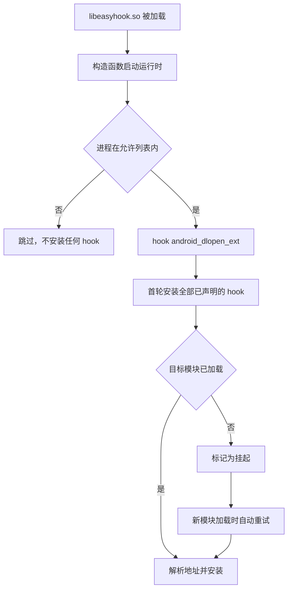

<div align="center">

# Easy Hook

**面向新手的 Android 原生 Hook 框架**

只写一个 cpp，声明要 hook 什么、hook 成什么，其余全部自动完成。

[](#构建)
[](#构建)
[](CMakeLists.txt)
[](CMakeLists.txt)

[快速开始](#快速开始) ·
[三种定位方式](#三种定位方式) ·
[构建](#构建) ·
[日志与排查](#日志与排查) ·
[架构](#架构)

</div>

## 这个框架解决什么问题

写一个 native hook，通常要自己处理符号解析、模块基址换算、hook 安装、原函数保存、
目标库还没加载时的等待、以及各种失败情况的排查。这些和你真正想做的事无关。

Easy Hook 把这些全部收进引擎，你只需要在 `user/` 目录写一个 cpp，声明两件事：

- **hook 什么**：模块名加符号名、模块名加偏移，或者一段字节特征码
- **hook 成什么**：一个函数体，需要时用 `EASY_ORIGINAL(...)` 调回原逻辑

不需要写注册代码，不需要写初始化代码，不需要改 CMakeLists，也不需要关心目标库有没有加载。

## 快速开始

在 `user/` 目录下新建任意名字的 cpp：

```cpp
#include "easy_hook/easy_hook.hpp"

EASY_HOOK_SYMBOL(OpenFile, "libc.so", "open", int, const char* path, int flags) {
    EASY_LOG("open path=%s flags=0x%x", path, flags);
    return EASY_ORIGINAL(path, flags);
}
```

然后构建：

```powershell
.\scripts\build-android.ps1
```

产物是 `build-android-ninja/libeasyhook.so`。把它加载进目标进程即可生效，
ROM 预置、Zygisk 模块、手动 `dlopen` 都可以，框架不绑定任何一种加载方式。

宏的参数顺序固定为 `(名字, 目标定位..., 返回类型, 参数列表...)`。
第一个参数是你给这个 hook 起的名字，只用于日志和状态查询，随便起，不要重复即可。

## 三种定位方式

### 按符号名

最常用。符号可以是未导出的内部符号，框架会解析目标模块的 `.symtab` 与 `.dynsym`。

```cpp
EASY_HOOK_SYMBOL(PrettyMethod, "libart.so",
                 "_ZN3art9ArtMethod12PrettyMethodEb",
                 const char*, void* thiz, bool with_signature) {
    const char* name = EASY_ORIGINAL(thiz, with_signature);
    EASY_LOG("PrettyMethod -> %s", name);
    return name;
}
```

模块名必须填写，且尽量填准。留空会让底层符号解析器遍历并映射所有已加载模块，代价极高。

### 按模块加偏移

偏移**直接填 IDA 中显示的地址**。框架内部用模块的 `load_bias` 换算成运行时绝对地址，
并校验该地址确实落在某个已映射段内，填错时会明确报错而不是静默 hook 到错误位置。

```cpp
EASY_HOOK_OFFSET(DamageCalculate, "libgame.so", 0x1A2B0, int, void* self, int raw) {
    EASY_LOG("damage raw=%d forced to 0", raw);
    return 0;
}
```

> [!NOTE]
> 这里不能用 `/proc/self/maps` 的首行基址加偏移。模块存在多个 PT_LOAD 段时两者并不相等，
> 那是一个常见的错误来源。框架已经处理好这一点，你只管填 IDA 里看到的地址。

### 按字节特征码

应对无符号且版本多变的目标。`??` 表示任意字节，分隔符可以是空格或逗号。

```cpp
EASY_HOOK_PATTERN(EncryptBuffer, "libgame.so", "FF 83 00 D1 ?? ?? 00 F9",
                  int, void* buffer, int length) {
    EASY_LOG("encrypt length=%d", length);
    return EASY_ORIGINAL(buffer, length);
}
```

搜索范围限定在目标模块的可执行段。**命中多于一处会拒绝安装**，因为那说明特征码不够唯一，
继续安装会在不同版本的目标库上 hook 到错误位置。遇到这种情况请加长特征码。

特征码首字节不允许是通配符，否则搜索会退化为逐字节全量比对且极易误命中。

## 可选能力

### 只在指定进程生效

注入到 zygote 后所有 app 进程都会继承，通常需要过滤。在任意 user cpp 中声明：

```cpp
EASY_HOOK_ONLY_IN("com.example.game")
```

可重复声明以允许多个进程。支持 `包名:子进程` 形式的匹配，即 `com.example` 也会覆盖
`com.example:remote`。完全不声明时不做过滤，注入到哪就在哪生效。

### 不调用原函数

直接 return，不写 `EASY_ORIGINAL` 即可完全接管该函数。

### 判断是否安装成功

`EASY_HAS_ORIGINAL()` 返回原函数是否已成功接管，用于替换函数中需要区分该情况的场合。

### 主动查询状态

```cpp
easy::DumpStatus();                 // 打印每个 hook 的目标、状态和绝对地址
const auto pending = easy::PendingCount();  // 仍在等待目标模块加载的数量
const auto summary = easy::InstallAll();    // 主动触发一轮安装
```

## 安装时机

框架在 `libeasyhook.so` 被加载时通过构造函数自动启动，你不需要调用任何初始化函数。

启动时会先 hook `android_dlopen_ext` 建立模块加载监听，再执行首轮安装。
目标模块尚未加载的 hook 会进入**挂起**状态，等到该模块被加载时自动补装。
因此即使你要 hook 的是一个稍后才被 `dlopen` 进来的库，也不需要做任何额外处理。



只有"目标模块未加载"属于可重试的暂时性失败。符号不存在、偏移越界、特征码不唯一
都是终态，不会反复重试，以免在每次 `dlopen` 上做无用的解析。

## 构建

### 环境要求

| 项目 | 要求 |
| --- | --- |
| 宿主系统 | Windows + WSL |
| CMake | 3.28 或更高 |
| 构建器 | Ninja |
| Android NDK | r29 |
| 目标 ABI | `arm64-v8a` |
| 最低 API | Android 11 / API 30 |
| C++ 标准 | C++23 |

### 一键构建

```powershell
.\scripts\build-android.ps1
```

指定自定义路径与选项：

```powershell
.\scripts\build-android.ps1 `
  -NdkPath /opt/android-ndk-r29 `
  -BuildDir build-android-ninja `
  -BuildType Release `
  -DebugLogging ON
```

<details>
<summary><strong>在 WSL 中手动构建</strong></summary>

```bash
cmake -G Ninja -S . -B build-android-ninja \
  -DCMAKE_BUILD_TYPE=Release \
  -DCMAKE_TOOLCHAIN_FILE=/opt/android-ndk-r29/build/cmake/android.toolchain.cmake \
  -DANDROID_ABI=arm64-v8a \
  -DANDROID_PLATFORM=android-30 \
  -DANDROID_STL=c++_static \
  -DEASY_HOOK_DEBUG_DEFAULT=ON

cmake --build build-android-ninja --target easyhook --parallel
sha256sum build-android-ninja/libeasyhook.so
```

</details>

## 日志与排查

```bash
adb logcat -s "EASY-HOOK:*"
```

开启调试日志后还会追加写入 `/data/local/tmp/easy_hook.log`。

| 系统属性 | 默认值 | 作用 |
| --- | --- | --- |
| `persist.easy_hook.debug` | 构建配置，默认 `1` | 输出 Info 级日志并写入日志文件 |
| `persist.easy_hook.verbose` | `0` | 额外输出 Debug 级日志，含地址解析细节 |

### 日志标签

| 标签 | 关注内容 |
| --- | --- |
| `bootstrap` | 库是否被成功加载、运行时启动结果 |
| `runtime` | 进程过滤判定、模块监听是否就绪、首轮安装汇总 |
| `registry` | 每个 hook 的目标、状态与解析出的绝对地址 |
| `engine` | 单个 hook 的定位与安装结果 |
| `offset-locator` | 偏移换算细节，可与 IDA 核对 |
| `pattern-locator` | 特征码解析与命中次数 |
| `module-watcher` | 新模块加载与挂起项补装 |
| `user` | `EASY_LOG` 输出的内容 |

### 安装状态含义

| 状态 | 含义与处理 |
| --- | --- |
| `installed` | 已成功安装 |
| `module_not_loaded` | 目标模块尚未加载，等待自动补装，通常无需处理 |
| `symbol_not_found` | 模块已加载但符号不存在，检查符号名拼写与是否被裁剪 |
| `offset_out_of_range` | 偏移不在任何已映射段内，检查是否填错模块或填了文件偏移 |
| `pattern_invalid` | 特征码语法错误，或首字节是通配符 |
| `pattern_not_found` | 可执行段中没有命中，检查目标版本是否变化 |
| `pattern_ambiguous` | 命中多处，特征码不够唯一，需要加长 |
| `backend_failed` | 地址已解析但 inline hook 安装失败，通常是目标指令无法重定位 |
| `skipped_process_filter` | 当前进程不在 `EASY_HOOK_ONLY_IN` 允许列表中 |

### 排查顺序

1. **完全没有日志**：确认 `libeasyhook.so` 真的被加载，构造函数日志 `libeasyhook loaded` 是否出现
2. **提示 no_registration**：`user/` 下没有任何 hook 声明，或声明被 `#if 0` 注释掉了
3. **一直是 pending**：确认目标模块名拼写正确，并检查 `module-watcher` 是否成功建立监听
4. **地址对不上**：开启 verbose，用 `offset-locator` 打印的 `load_bias` 与绝对地址和 IDA 核对

## 架构

```text
main/
├── include/easy_hook/
│   ├── easy_hook.hpp       使用者唯一需要包含的总头
│   ├── macros.hpp          三个 hook 宏与辅助宏
│   ├── core/               日志、目标规格、注册表、引擎、运行时、进程过滤
│   ├── module/             基于 dl_iterate_phdr 的模块查询
│   ├── pattern/            字节特征码解析与搜索
│   ├── locator/            符号、偏移、特征码三种定位器
│   ├── backend/            inline hook 抽象接口与 Dobby 实现
│   └── loader/             模块加载监听
├── src/                    与 include 一一对应的实现
├── user/                   使用者写 hook 的唯一位置
├── dobby/                  上游 Dobby 依赖
└── scripts/                构建脚本
```

### 关键设计

**引擎不依赖具体 hook 库。** 引擎只面向 `backend::InlineHookBackend` 抽象接口编程，
Dobby 只是它的一个实现。后续接入 ART 方法 hook 时新增一个 backend 即可，
引擎、注册表和定位层都不需要改动。

**注册表使用函数内静态单例。** 每个 hook 的自注册对象分散在不同翻译单元的静态构造期，
单例延迟到首次访问时才创建，从根本上避免静态初始化顺序问题。

**用户代码编译为 OBJECT 库。** 静态库中未被引用的目标文件会被链接器丢弃，
那样每个 hook 的自注册对象都不会执行，所有 hook 都将静默失效。
OBJECT 库的目标文件会被无条件链入，保证注册一定发生。

**用户代码与框架代码使用不同的告警级别。** 框架本体开启 `-Wpedantic -Wconversion`,
用户 hook 只开 `-Wall -Wextra`，避免新手在写替换函数时被严格告警劝退。

### 当前不支持

- JNI 原生方法 hook（替换 `JNINativeMethod.fnPtr`），计划在二期加入
- Java 方法 hook，二期通过接入 LSPlant 作为新 backend 实现
- 导入表 / PLT 替换。Dobby 的实现基于 Mach-O 且只在 Darwin 下编译，Android 上不可用
- arm64-v8a 以外的 ABI

---

<div align="center">

<sub>把 hook 的复杂度收进框架，把注意力留给真正要解决的问题。</sub>

</div>
