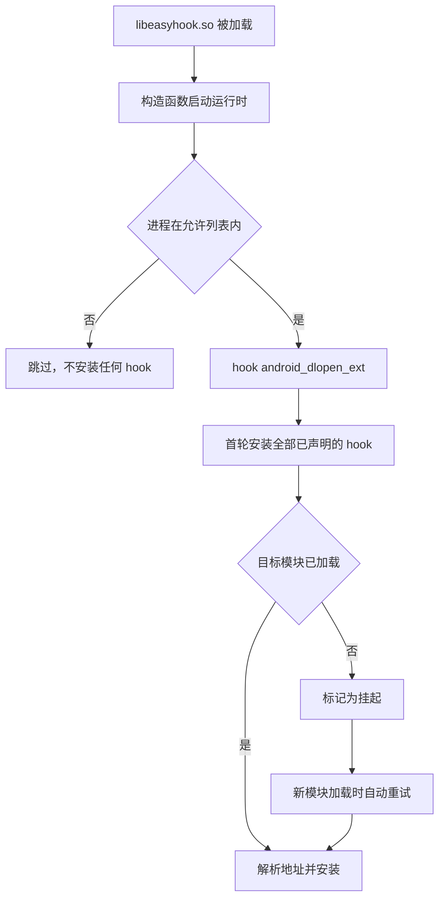

# Hook 写法

[← 返回首页](../README.md) · [插件编写](plugins.md) · [Hook 写法](hooking.md) · [ART hook](art-hook.md) · [内置插件](builtin-plugins.md) · [构建与部署](build.md) · [日志与排查](troubleshooting.md) · [架构](architecture.md)

## 三种定位方式

### 按符号名

最常用。符号可以是未导出的内部符号，框架会解析目标模块的 `.symtab` 与 `.dynsym`。

```cpp
EASY_HOOK_SYMBOL(PrettyMethod, "libart.so",
                 "_ZN3art9ArtMethod12PrettyMethodEb",
                 const char*, void* thiz, bool with_signature) {
    const char* name = EASY_ORIGINAL(thiz, with_signature);
    EASY_LOG("PrettyMethod -> %s", name);
    return name;
}
```

模块名必须填写且尽量填准。留空会让解析器遍历并映射所有已加载模块，代价极高。

### 按模块 + 偏移

偏移**直接填 IDA 中显示的地址**。框架用模块的 `load_bias` 换算成运行时地址，
并校验该地址落在已映射段内，填错会明确报错，而不是静默 hook 到错误位置。

```cpp
EASY_HOOK_OFFSET(DamageCalculate, "libgame.so", 0x1A2B0, int, void* self, int raw) {
    EASY_LOG("damage raw=%d forced to 0", raw);
    return 0;
}
```

> [!NOTE]
> 不要用 `/proc/self/maps` 首行基址 + 偏移。模块有多个 PT_LOAD 段时两者并不相等，
> 这是常见错误来源，框架已经处理好了。

### 按字节特征码

应对无符号且版本多变的目标。`??` 表示任意字节，分隔符可以是空格或逗号。

```cpp
EASY_HOOK_PATTERN(EncryptBuffer, "libgame.so", "FF 83 00 D1 ?? ?? 00 F9",
                  int, void* buffer, int length) {
    EASY_LOG("encrypt length=%d", length);
    return EASY_ORIGINAL(buffer, length);
}
```

- 搜索范围限定在目标模块的可执行段
- **命中多于一处会拒绝安装**（`pattern_ambiguous`），请加长特征码
- 首字节不允许是通配符，否则搜索会退化为逐字节全量比对且极易误命中

## 可选能力

### 只在指定进程生效

注入 zygote 后所有 app 进程都会继承，可以在任意 cpp 中声明进程白名单：

```cpp
EASY_HOOK_ONLY_IN("com.example.game")
```

可重复声明以允许多个进程；`com.example` 同时覆盖 `com.example:remote`。不声明则不过滤。

### 其他

| 写法 | 作用 |
| --- | --- |
| 不写 `EASY_ORIGINAL` 直接 return | 完全接管该函数 |
| `EASY_HAS_ORIGINAL()` | 原函数是否已成功接管 |
| `easy::DumpStatus()` | 打印每个 hook 的目标、状态和绝对地址 |
| `easy::PendingCount()` | 仍在等待目标模块加载的数量 |
| `easy::InstallAll()` | 主动触发一轮安装 |

## 安装时机

`libeasyhook.so` 被加载时通过构造函数自动启动，无需调用任何初始化函数。
启动时先 hook `android_dlopen_ext` 建立模块加载监听，再执行首轮安装；
目标模块尚未加载的 hook 进入**挂起**状态，等该模块加载时自动补装。



只有"目标模块未加载"会重试。符号不存在、偏移越界、特征码不唯一都是终态，不会在每次 `dlopen` 上重复解析。
